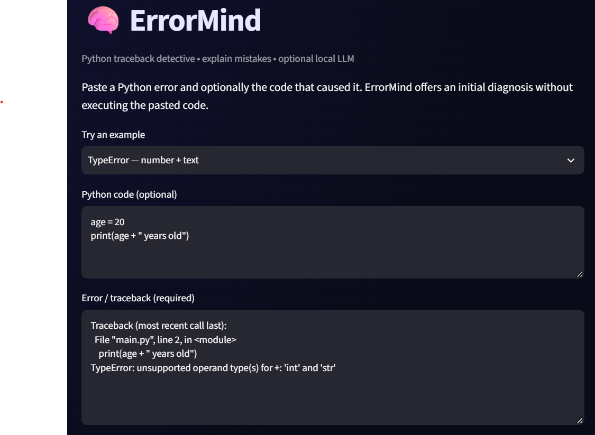
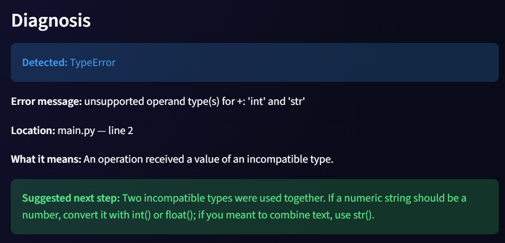
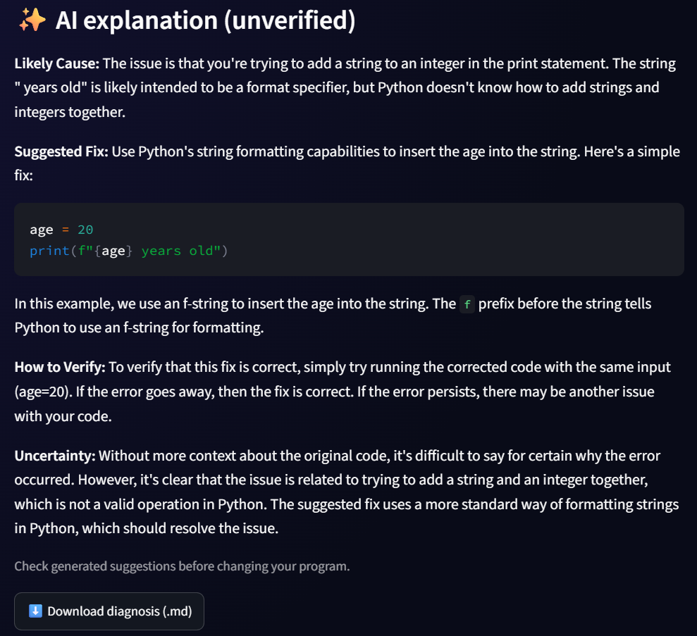

# ErrorMind — Python Error Explainer (Student Prototype)

A small, local-first Streamlit application that explains common Python exceptions, finds traceback line numbers, and recommends debugging steps. It **never runs pasted code**.

For optional generative-AI explanations, it can call a **local Ollama model** such as `llama3.2` through `http://127.0.0.1:11434/api/generate`.

## Features

- Recognize common Python exceptions (NameError, TypeError, IndexError, ZeroDivisionError, etc.).
- Extract source filename and line number when the traceback contains them.
- Display a cautious explanation and next debugging step.
- Optional AI-generated explanation from a *local* Ollama model; no paid API key needed.
- Download a Markdown report.
- Include preloaded sample errors and a Python standard-library test suite.

## Run on Windows (PowerShell)

```powershell
py -3 -m venv .venv
.\.venv\Scripts\python.exe -m pip install -r requirements.txt
.\.venv\Scripts\python.exe -m streamlit run app.py
```

Then visit the local URL shown (typically `http://localhost:8501`).

## Optional: use the AI feature

Ollama must be installed and running **on the same computer**.

```powershell
ollama list
ollama pull llama3.2
```

Check **Add an AI-generated explanation** in the interface and select the exact installed model name. If Ollama is unavailable, the basic rule-based analysis continues to work.

## Run tests

```powershell
.\.venv\Scripts\python.exe -m unittest discover -s tests -v
```

## Architecture

- `app.py`: Streamlit UI and optional Ollama API call.
- `analyzer.py`: deterministic, inspectable error detection and guidance.
- `tests/test_analyzer.py`: unit tests for analyzer behavior.

## Limitations and privacy

- Rule-based diagnosis is not itself generative AI.
- LLM suggestions can be inaccurate; verify fixes in a safe development environment.
- ErrorMind does not execute pasted code, install packages, or change files.
- Only enabling the Ollama option sends input to the local Ollama HTTP API; avoid pasting secrets.
- A publicly deployed Streamlit app **cannot call your laptop's local Ollama instance** by default; that feature only works locally or with a suitable separately hosted backend.

## Credits

This learning starter was prepared with AI assistance. Adapt, test, and document the changes you make yourself before representing it as an independent project.
## Application Screenshots

### 1. ErrorMind Interface


### 2. Python Error Diagnosis


### 3. AI-Powered Explanation with Llama 3.2
